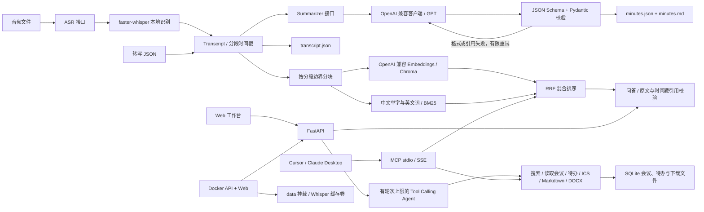

# MeetMind

按 [设计 v2](docs/design-v2.md) 实现 M1 + M2 + M3：音频转纪要、Agent 工具调用、带时间戳引用的历史会议混合检索问答、FastAPI/Web 工作台、MCP 和 Docker 部署。

## 架构



`src/meetmind/asr/` 定义转写接口和本地实现；`summarize/` 定义纪要接口、提示词和客户端；
`models.py` 定义数据契约；`pipeline.py` 编排 CLI 流程；`tools/` 提供导出与行动工具；
`storage.py`、`retrieval/`、`agent/`、`service.py` 分别负责持久化、检索、工具循环和服务编排。
`api.py` 提供 API 并直接服务包内的轻量 HTML/JavaScript 界面，无需前端构建或 CDN。
测试通过注入假 ASR 和假客户端隔离模型，离线 demo 使用明确标记的固定响应。

## 快速开始（PowerShell）

Python 3.10+。本机可使用指定解释器，无需 Git：

```powershell
& D:\python\python.exe -m venv .venv
& .\.venv\Scripts\python.exe -m pip install -e ".[dev,asr]"
# 也可以只安装 .[dev]，运行转写 JSON、离线 demo 和全部单元测试
& .\.venv\Scripts\meetmind.exe demo
Copy-Item .env.example .env
# 编辑 .env 填写 OPENAI_API_KEY，然后运行真实音频：
& .\.venv\Scripts\meetmind.exe run audio.wav --output-dir outputs/first-meeting
```

Linux/macOS：`python -m venv .venv`，随后使用 `.venv/bin/python` 和 `.venv/bin/meetmind`。
无需激活虚拟环境。不要重复创建已有虚拟环境；输出目录必须尚不存在。
省略 `--output-dir` 时会在 `outputs/` 中创建带随机后缀的新目录，避免覆盖。

首次本地 ASR 使用会下载模型权重，需要网络和磁盘空间；`ASR_MODEL` 可以设为已下载的本地模型目录。
默认 CPU / int8，语言自动识别；支持音频格式取决于 faster-whisper 的音频解码器。
默认模型为 `medium`，仍可通过 `ASR_MODEL` / `WHISPER_MODEL` 覆盖。选择依据是
[既有实测](docs/e2e/asr-compare-20261105/README.md)的主参考子集：近场 CER **28.20%**、
远场 **39.53%**，均低于 small；代价是本机 CPU/int8 的近场/远场 RTF 从 small 的
0.236/0.194 升至 medium 的 0.531/0.449。仅代表该会话子集，完整 CER 表及限制见文末。
无语音或无效录音会失败，不生成虚构转写。模型运行环境及 GPU 依赖参见
[faster-whisper 官方说明](https://github.com/SYSTRAN/faster-whisper#usage)。

## Docker：三步启动

1. 首次创建配置：Linux/macOS 执行 `cp -n .env.example .env`；PowerShell 执行
   `if (!(Test-Path .env)) { Copy-Item .env.example .env }`。已有 `.env` 直接沿用。
2. 编辑本机 `.env`：填写 `LLM_BASE_URL`、`LLM_API_KEY`、`LLM_MODEL`、`WHISPER_MODEL`
   （旧 `OPENAI_*` / `ASR_MODEL` 仍有效），并确认 `EMBEDDING_MODEL` 可由同一服务调用。
   只看离线 demo 时设 `MEETMIND_DEMO=1`，无需密钥或模型下载。
3. 执行 `docker compose up --build -d`，打开 `http://localhost:8000`；
   用 `curl http://localhost:8000/health` 检查进程存活。

API 与 Web 由同一进程提供，宿主端口只绑定本机。`./data` 挂载到 `/app/data`，保存 SQLite、
Chroma 和上传临时目录 `uploads/`；原始上传音频在转写后清理，不作为永久归档。
Compose 固定容器数据目录，不受旧 `.env` 中宿主路径影响。首次转写音频时才下载 Whisper 权重，
保存在命名卷 `whisper-cache` 的 `/models/huggingface`，重建容器可复用；镜像不含权重。
需要镜像源时在 `.env` 添加 `HF_ENDPOINT=https://hf-mirror.com`，重建容器配置后生效。
也可将本地权重目录另行挂载并把 `WHISPER_MODEL` 指向容器内路径。
`docker compose logs -f api` 查看日志，`docker compose down` 停止服务并保留数据卷。
`/health` 默认返回进程存活 200，并报告 LLM、embedding、ASR 的配置是否齐全，不访问外部服务。
`ready` 在默认模式只表示配置齐全，不保证依赖可用。设置 `MEETMIND_HEALTH_DEEP=1` 后，
对配置的聊天和 embedding 模型各发一次最小请求（每次超时 3 秒、不重试，可能产生费用），
ASR 只检查可选包及配置目录的 `model.bin`，不加载模型或下载权重；模型名或缓存未解析时报告
`weights_unverified`。深度检查任一依赖缺失、不可用或未验证时返回 503；普通检查仍为 200。
离线 demo 标为 `demo_bypass`，不探测线上依赖。响应不包含密钥、服务地址或上游错误正文。

## MCP：Cursor / Claude Desktop

安装 `pip install -e ".[dev]"` 后，`meetmind-mcp` 或 `python -m meetmind.mcp_server`
默认使用 stdio。实现使用[官方 MCP Python SDK v1](https://py.sdk.modelcontextprotocol.io/v1/)，
依赖固定为 `mcp<2`。工具复用 Web/Agent 的 `Tools.call`、混合检索和服务初始化；
注册及启动不会提前连接模型或加载 Chroma，首次调用才初始化服务。

将下列 `mcp.json` 内容用于 Cursor 的 `.cursor/mcp.json`，或合并到 Claude Desktop 的
`claude_desktop_config.json`。把两处 `D:/projects/MeetMind` 替换为实际仓库绝对路径；
Linux/macOS 将 Python 改为 `.venv/bin/python` 的绝对路径。
`--directory` 指定现有 `.env` 和相对数据目录的工作目录，密钥保留在本机 `.env` 中。

```json
{
  "mcpServers": {
    "meetmind": {
      "command": "D:/projects/MeetMind/.venv/Scripts/python.exe",
      "args": ["-m", "meetmind.mcp_server", "--directory", "D:/projects/MeetMind"]
    }
  }
}
```

| MCP 工具 | 参数与行为 |
|---|---|
| `search_meetings` | `query`、`k=5`（1–10）；返回 `sources`，含会议 ID、原文、分段 ID 和 `start/end` 秒数 |
| `get_meeting_summary` | `meeting_id`；读取已保存的纪要、决策与行动项，不重新生成摘要 |
| `create_todo` | `meeting_id`、`action_index`（从 0 开始）；保存既有行动项，幂等 |
| `create_calendar_event` | `meeting_id`、`title`、`start`、`end`；时间需带明确时区偏移，生成 ICS |
| `export_markdown` | `meeting_id`；导出纪要与带时间戳转写 |

演示：先按上文启动离线 Web 工作台并导入虚构示例，让 MCP 使用同一
`MEETMIND_DATA_DIR` 和 `MEETMIND_DEMO=1`，然后在客户端要求“搜索预算相关会议”，
用返回的 `meeting_id` 获取摘要，再明确要求保存第一个行动项或导出 Markdown。
返回的 `/artifacts/...` 为相对下载地址；使用相同数据目录的 Web 服务可在
`http://localhost:8000/artifacts/...` 下载。ICS 仅生成文件，不写入外部日历。

可选 SSE：`meetmind-mcp --transport sse --host 127.0.0.1 --port 8001`，
客户端连接 `http://127.0.0.1:8001/sse`。SSE 服务独立于 Web 的 8000 端口；
默认本机使用，无认证。stdio 客户端会启动子进程，请勿将普通日志写入 stdout。

## 配置与数据流

`.env` 默认从当前工作目录读取，或用 `--env-file path/to/.env` 指定；系统环境变量优先。
`.env.example` 是应纳入版本控制的配置模板，`.env` 已忽略。本目录已初始化 Git 仓库。

| 配置 | 默认值 / 用途 |
|---|---|
| `OPENAI_API_KEY` | 必填，仅真实 LLM 调用需要 |
| `OPENAI_BASE_URL` | `https://api.openai.com/v1`，可改兼容服务 |
| `OPENAI_MODEL` | `gpt-4o-mini`，可按服务支持情况修改 |
| `LLM_API_KEY` / `LLM_BASE_URL` / `LLM_MODEL` | 对应上述三个旧名称；同一来源内非空新名称优先，系统环境始终优先于 `.env` |
| `LLM_RESPONSE_FORMAT` | `json_schema`；兼容服务可显式改为 `json_object` 或 `text` |
| `LLM_TIMEOUT_SECONDS` | `60`，单次请求超时 |
| `LLM_MAX_ATTEMPTS` | `3`，结构化结果校验尝试上限 |
| `MAX_TRANSCRIPT_CHARS` | `60000`，发送的转写 JSON 字符数上限，超过则报错 |
| `ASR_MODEL` | `medium`，模型名称或本地路径；质量与 RTF 取舍见上文 |
| `WHISPER_MODEL` | `ASR_MODEL` 的兼容别名，优先规则同上 |
| `ASR_DEVICE` / `ASR_COMPUTE_TYPE` | `cpu` / `int8` |
| `ASR_LANGUAGE` | 留空自动识别，或指定 `zh` / `en` 等 |
| `EMBEDDING_MODEL` | `text-embedding-3-small`；与聊天共用 API key/base URL，服务须支持 embeddings |
| `MEETMIND_DATA_DIR` | `outputs/server`，服务器的 SQLite 与 Chroma 数据目录 |
| `MEETMIND_DEMO` | `0`；设为 `1` 使用明确标记的离线演示实现 |
| `MEETMIND_HEALTH_DEEP` | `0`；设为 `1` 启用有超时限制的依赖探测，不可用时 `/health` 返回 503 |

使用官方 Python SDK 的 Chat Completions 接口。默认向服务传递严格 JSON Schema，
并在本地再次校验字段类型及来源分段 ID；兼容模式也执行同样的本地校验。
参考 [OpenAI Structured Outputs](https://developers.openai.com/api/docs/guides/structured-outputs?api-mode=chat)。
服务不支持某种格式时会明确失败，不静默切换服务或模型。
SDK 对暂时性请求错误最多重试 2 次，结构化结果另按 `LLM_MAX_ATTEMPTS` 重试；
拒绝请求立即失败，截断、非法 JSON、字段或来源校验失败会重新请求完整结果。

音频由本地 ASR 处理；真实模式下，转写、检索片段、问题和 Agent 对话会发送到所配置的模型服务，
转写分块与查询也会发送到 embeddings 接口；请使用有权处理的会议资料。
CLI 不打印密钥或原始 API 错误响应。结果包含会议文本，默认保存在已忽略的 `outputs/`。

## 输出和单独重试

每次成功运行生成：

- `transcript.json`：`language`、`segments`；每段有唯一 `id`、秒数 `start/end`、`text`、可空 `speaker`。
- `minutes.json`：`title`、`summary`、`topics`、`decisions`、`action_items`。
- `minutes.md`：人可读纪要、原文时间戳和跳转到分段的引用。

议题含 `title/discussion/source_segment_ids`；决策含 `text/source_segment_ids`；行动项含
`task/owner/due/source_segment_ids`。`owner`、`due` 未提及时必须为 `null`，无决策等使用空列表。
相对截止时间保留原话，不猜日期；本地 ASR 不进行说话人分离，`speaker` 为 `null`。
字段校验和有效引用不等于事实正确，真实纪要仍需人工核对。

在 LLM 调用前保存 `transcript.json`。若调用失败，保留转写以便重试：

```powershell
& .\.venv\Scripts\meetmind.exe summarize outputs/first-meeting/transcript.json --output-dir outputs/retry
# 对项目自带的原创虚构转写调用真实 LLM：
& .\.venv\Scripts\meetmind.exe summarize src/meetmind/samples/meeting.transcript.json
# 完全离线，不读取 .env，不下载 ASR 模型，不调用 LLM：
& .\.venv\Scripts\meetmind.exe demo --output-dir outputs/offline-demo
```

示例及对应固定纪要随包安装，许可与来源见 [samples/README.md](samples/README.md)。
Demo 的时间戳和纪要均为手工编写，不能作为音频识别或模型抽取质量的证据。
M1/M2 初始交付仅做离线验证；后续真实音频、LLM 和检索评测见文末实测章节。

## M2：启动 Web 工作台

先执行 `pip install -e ".[dev]"` 更新已有虚拟环境；上传真实音频另需 `.[asr]`。

```powershell
# 完全离线的 M2 演示，无需密钥、ASR 权重或嵌入模型下载：
$env:MEETMIND_DEMO = "1"
$env:MEETMIND_DATA_DIR = "outputs/web-demo"
& .\.venv\Scripts\python.exe -m uvicorn meetmind.api:app --host 127.0.0.1 --port 8000
```

打开 `http://127.0.0.1:8000`，点击「导入虚构示例」，然后检索问答、保存待办、导出文件，或发送 Agent 消息。
离线模式使用确定性的哈希向量、原文摘录回答和固定的「搜索 → 展示结果」Agent 流程，**不代表真实模型推理或检索质量**。
按钮仍会调用真实工具并写入本地 SQLite；离线 Agent 本身只演示搜索，不根据自然语言执行写入。
离线模式不支持音频；无纪要的 JSON 导入仅接受内置虚构转写，其他转写需同时提供纪要。

真实模式：停止服务，将 `MEETMIND_DEMO` 设为 `0`，配置 `.env` 中的 key、聊天模型、embedding 模型，
然后用相同命令启动。建议设置独立的 `MEETMIND_DATA_DIR`，避免混入演示数据。
服务器从当前目录读取 `.env`，环境变量优先；更改配置后需要重启。
端口可按本机情况更换。服务面向本机单用户，无认证；默认仅绑定 loopback。

工作台支持上传音频或导入 M1 的 `transcript.json`，可同时导入 `minutes.json` 跳过摘要调用。
每次导入创建独立会议 ID；重复导入会产生另一条会议。会议、待办、导出文件和向量索引在重启后保留。
待办取自会议中的行动项（不改写负责人/截止时间），同一会议同一行动项重复保存返回同一待办。
日历要求绝对起止时间和明确时区，输出 `.ics`，不会自动添加到系统日历。
DOCX 为可编辑文本，含纪要、来源分段编号与时间戳转写；Markdown 同样保留来源。

Agent 使用 OpenAI 兼容 Chat Completions 的 `tools` 协议，最多 6 轮、每轮最多 8 个工具调用，
参数通过 Pydantic 校验，仅开放固定工具，不接受模型指定文件路径。写入会直接执行到本地存储，
没有独立审批流；提示词要求只执行用户请求的操作，但这不是对提示注入的安全保证。
Web 对话由浏览器在后续请求中带回，最多最近 20 条，刷新或清空后丢弃；没有跨页面会话存储。
`/chat` 使用 SSE 逐步发送开始、已完成工具、最终回答或错误事件，**尚未实现模型逐 token 流式输出**。
失败前已完成的工具操作保留，重试前请检查待办和下载结果；日历及导出文件不做跨请求去重。

检索按完整转写分段分块（目标 1200 字符，单段过长时保持原段），Chroma 向量结果与 BM25
通过 Reciprocal Rank Fusion 合并。索引使用显式 embeddings，禁用 Chroma 默认模型下载。
更换 embedding 模型或 base URL 后使用不同 collection，并从 SQLite 恢复该索引。
问答 JSON 校验引用必须来自本次检索结果，返回会议 ID、标题、分段 ID、起止秒数和原文；
无记录或无引用时明确返回依据不足。有效引用只保证出处存在，不保证模型陈述被原文支持。
当前没有重排模型、相关度拒答阈值、会议日期过滤或“上周”等时间范围推断。

API 文档在 `http://127.0.0.1:8000/docs`：

| 接口 | 用途 |
|---|---|
| `POST /meetings` | `{transcript, minutes?}` 导入并索引；不提供纪要时调用 summarizer |
| `GET /meetings`、`GET /meetings/{id}` | 会议列表和原文/纪要 |
| `POST /audio?extension=.wav` | 原始音频字节，`Content-Type: application/octet-stream`，最多 50 MiB；内存接收 |
| `POST /search`、`POST /ask` | `{query, k?: 1..10}`；检索或带引用问答 |
| `POST /chat` | `{message, history?: [{role: user/assistant, content}]}`；SSE 事件流 |
| `POST /tools` | `{name, arguments}`；`get_meeting/create_todo/create_calendar_event/export_markdown/export_docx/search_meetings` |
| `GET /todos`、`GET /artifacts/{id}` | 已保存待办和生成文件下载 |
| `GET /health`、`GET /sample` | 存活与依赖配置/可选深度探测、虚构输入样例 |

Chroma 的接口用法参考[官方 Python API](https://docs.trychroma.com/reference/python)，
API 测试通过[FastAPI 依赖覆盖](https://github.com/fastapi/fastapi/blob/master/docs/en/docs/advanced/testing-dependencies.md)注入离线服务。

## 开发与验证

本机最新验证（2026-11-06）：`pytest -q` **118 passed**（1 条既有 Chroma 弃用警告），
`ruff check .`、`ruff format --check .` 和 `pip check` 均通过；
官方 SDK stdio 客户端已完成握手、列出工具，并在临时离线 SQLite/Chroma 数据上调用全部五个工具。
本机未执行镜像构建；GitHub Actions 运行独立 `docker build` 作业，不推送镜像。

```powershell
& .\.venv\Scripts\ruff.exe check .
& .\.venv\Scripts\ruff.exe format --check .
& .\.venv\Scripts\python.exe -m pytest -q
```

测试不需要网络、密钥或 ASR 权重：保留 M1 全部覆盖，并增加工具参数与日历转义、待办幂等、
混合检索与引用、Agent 多轮与上限、API/SSE、模拟音频上传、下载文件解析、SQLite/真实 Chroma 重启读取。
普通网络连接被测试夹具阻断；Windows asyncio 内部 socketpair 是唯一受限豁免。
GitHub Actions 已在远端运行，覆盖 Python 3.10、3.12、3.14 的 lint、格式检查、离线测试与 demo，
以及独立 Docker 构建作业；最新状态见 [Actions](https://github.com/youli0828/MeetMind/actions)。

历史验证中 CLI 离线 demo、wheel 构建与包内 Web/样例资源检查通过。
历史本机 Edge 浏览器实测通过：虚构示例导入、时间戳引用展示、保存待办、下载并解析可编辑 DOCX/ICS、
Agent SSE 工具与最终回答；桌面与 390px 移动端页面无横向溢出、无 JavaScript 页面错误。
浏览器验证使用真实本地 Chroma 与离线演示模型；截图和报告保存在本机 `outputs/m2-browser-8cbe865f/`，未纳入 Git。
这些结果仅验证软件行为，不是 ASR 或纪要质量评测。

## 路线图与限制

| 里程碑 | 状态与范围 |
|---|---|
| M1 | 已实现 CLI、ASR 接口及 faster-whisper、GPT 兼容调用、结构化校验与重试、JSON/Markdown、离线示例、测试及 CI 配置 |
| M2 | 已实现 Agent 工具循环、SQLite 待办、ICS/Markdown/DOCX、Chroma + BM25 RAG、带引用问答、FastAPI、Web 工作台与离线演示；验证与限制见本文 |
| M3 | 已实现 MCP stdio/SSE、Docker/Compose、CI 镜像构建、真实 CER 对比与远场 bad case；[小型业务评测](docs/e2e/business-eval/README.md)：离线 Recall@1/@2/@3=1.000（2 块/8 问）；已保存真实纪要 token 集合 F1=0.6437、严格行动项集合 F1=0（单场/3 项）。线上 embedding 召回与大样本评测仍 TODO |

说话人分离（diarization）、实时音频、长会议摘要分块和任务外部写入仍未实现。
历史检索分块已实现，但纪要生成仍受 `MAX_TRANSCRIPT_CHARS` 限制。
单元测试通过不代表模型效果；文末实测指标仅代表指定样本和配置。

历史真实 ASR、聊天及 embedding 调用结果见下文；离线业务指标与适用范围见[业务评测](docs/e2e/business-eval/README.md)。

MIT License。

## 真实端到端评测

真实端到端评测（2026-11-05，北京时间）：使用
[AliMeeting / OpenSLR 119](https://www.openslr.org/119/) 的
`R8001_M8004_MS801` 前 5 分钟、远场通道 0。来源为官方页面的国内阿里云下载源，
许可 **CC BY-SA 4.0**，署名 Alibaba Group / Yu et al., ICASSP 2022。
音频仅保存在已 gitignore 的 `data/external/`，不上传音频；转写和问题文本会发送到
`.env` 配置的智谱服务。文本结果、完整复现步骤和许可说明见 [docs/e2e](docs/e2e/README.md)。

| 实测项 | 结果 |
|---|---|
| 音频时长 | 300.000 秒 |
| faster-whisper | base / CPU / int8 / zh |
| 转写墙钟时间 | 19.848 秒，含模型初始化，不含权重下载 |
| 实时率 RTF | 0.06616（转写秒数 / 音频秒数） |
| 结构化纪要 | glm-4-flash / json_object；35.734 秒 |
| 纪要校验 | Schema 和来源 ID 均通过；1 次尝试，结构重试 0，HTTP 重试 0 |
| 检索问答 | embedding-3 + Chroma/BM25；索引及问答 4.837 秒，1 条引用 |
| 局部参考 CER | 58.43%，201/344 字；7 段、66.53 秒，独立裁切解码 |

问：“这段会议讨论了哪些主要问题？请依据原文回答。”
模型原答：“会议讨论了手机设计、目标人群、产品功能、市场定位、年龄适应性以及不同年龄段用户的需求差异等问题。”
引用范围 **00:06.860–04:50.300**，分段 ID 0–106，时间与原文核对通过，详见
[qa.json](docs/e2e/alimeeting-20261105-base-rerun/qa.json)。本次只有一个短会议检索块，
不能据此推断多会议检索召回率。

**流程跑通，内容质量仍有明显问题。** ASR 把开场产品研讨误转成“新规管理的主席”，
纪要随后也提取了这个错误议题。结构校验不能发现这种错误。
CER 来自第三方公开的带时间边界参考子集，参考文本已与 Icefall 日志的 `ref` 核对；
不做繁简转换，包含繁简差异、数字写法和口头语差异。
上述历史端到端运行未取得完整参考，未报告整段 CER/WER；上述 58.43% 不能当作整段 CER。
原始生成文本未人工润色；[metrics.json](docs/e2e/alimeeting-20261105-base-rerun/metrics.json)
和 [cer_subset.json](docs/e2e/alimeeting-20261105-base-rerun/cer_subset.json) 保存实际数值与方法。

### ASR 模型比较（2026-11-05）

沿用同一会话前 300 秒远场音频，从官方国内阿里云源取得匹配的 4 路耳麦音频，
近场条件为这 4 路音频的等权混合；近、远场官方标注的时间边界和文本均已核对一致。
本轮为本地 ASR 测量，不读取 `.env`，不调用 LLM；音频和权重均保存在 gitignore 的 `data/external/`。
统一使用 faster-whisper、CPU / int8 / zh、4 线程、VAD、beam size 5，设置 HF 国内镜像；
模型下载使用国内备用源后核验固定 revision 的哈希。已有 base 近、远场和 small 远场结果直接复用。

| 模型 | 远场 CER | 远场耗时(s) | 远场 RTF | 近场 CER | 近场耗时(s) | 近场 RTF |
|---|---:|---:|---:|---:|---:|---:|
| base | 58.43% | 17.91 | 0.060 | 36.34% | 23.89 | 0.080 |
| small | 45.06% | 58.09 | 0.194 | 34.30% | 70.79 | 0.236 |
| medium | 39.53% | 134.62 | 0.449 | 28.20% | 159.16 | 0.531 |
| large-v3-turbo | 41.28% | 99.98 | 0.333 | 29.65% | 112.82 | 0.376 |

CER 为历史相同的 7 段、66.53 秒、344 字参考子集，逐段独立解码；不做繁简转换。
耗时为完整 300 秒转写，含导入和初始化，不含下载、CER 评分；RTF = 耗时 / 300。
本轮 base 耗时与上方历史端到端测量不同，属于不同进程的单次实测。
已取得官方 TextGrid，另评分扩展无重叠子集（9 段、75.45 秒、393 字）及长前缀
（0–295.17 秒、1605 字）。长前缀包含重叠发言，参考按起点拼接，顺序会影响 CER；
不是官方重叠感知评分，也不是完整 300 秒 CER。

八组均完成，没有因硬件限制跳过模型。主子集上，medium 的近、远场 CER 均最低；
turbo 比 medium 快，但主子集 CER 略高。长前缀上 turbo 的近、远场 CER 则均低于 medium，
说明评分范围会影响排序。同模型近场 CER 均低于远场，但这里比较的是 4 路耳麦混合与远场单通道，
不能将差异完全归因于麦克风距离。
这只是单个会话、单次运行，不能外推为 AliMeeting 全集表现；CER 也不等于纪要质量。
完整方法、音频来源、峰值内存、扩展 CER、原始转写及逐段编辑距离见
[比较报告](docs/e2e/asr-compare-20261105/README.md)、
[完整表格](docs/e2e/asr-compare-20261105/comparison.md) 和
[汇总 JSON](docs/e2e/asr-compare-20261105/summary.json)。
该轮[核验记录](docs/e2e/asr-compare-20261105/verification.json)保存历史实际输出及数据检查结果；
当前测试总数统一见上文“开发与验证”。

### 远场 bad case（已有实测摘录）

以下均直接来自 [base-far/metrics.json](docs/e2e/asr-compare-20261105/base-far/metrics.json)
的 `cer_subset.excerpts`，为独立裁切解码的原始结果，未做繁简转换或人工修正。
参考与衍生文本沿用 AliMeeting 的 CC BY-SA 4.0，署名 Alibaba Group / Yu et al., ICASSP 2022。

| 时间（秒） | 官方参考 | base 远场识别 |
|---|---|---|
| 6.90–18.29 | 好嗯，咱们今天针对咱们公司新出产的新出的一款这个手机啊产品啊，进行一下这个研讨会首先咱们确认一下咱们这个产品的目标，这个人群客户群这一块儿。 | 好 等於今天就是能夠自信出場聽出一款用的產品今天一家編號會我再讓大家去看一下產品的目標這個人群 扣群那一款 |
| 18.73–22.43 | 嗯，首先谈一下大家伙的一个看法啊嗯，那。 | 我今天還跟大家補一個套 |

两例存在内容替换和漏词，错误会传递到下游纪要；来源 ID 和 Schema 校验无法纠正识别内容。
检索与行动项的小型离线实测见[业务评测](docs/e2e/business-eval/README.md)；
线上 embedding Recall@k、大样本行动项 F1、完整数据集 CER/WER：**TODO / later**。

### 历史端到端评测复现

复现时先安装 `.[dev,asr]`，并使用现有 `.env`；换用尚不存在的新输出目录。
权重下载前设置镜像；下载脚本支持国内备用源并核对完整 SHA-256：

```powershell
$env:HF_ENDPOINT = "https://hf-mirror.com"
$env:HF_HUB_DISABLE_XET = "1"
& .\.venv\Scripts\python.exe docs/e2e/download_alimeeting.py
& .\.venv\Scripts\python.exe docs/e2e/download_base.py
& .\.venv\Scripts\python.exe docs/e2e/evaluate_alimeeting.py `
  --model-path data/external/faster-whisper-base --output-dir docs/e2e/new-run
& .\.venv\Scripts\python.exe docs/e2e/evaluate_cer_subset.py --run-dir docs/e2e/new-run
```

首次运行遇到 faster-whisper 1.2.1 / PyAV 19.0.2 解码参数不兼容，失败记录保留于
[首次运行目录](docs/e2e/alimeeting-20261105-base/metrics.json)。ASR 依赖已限制 `av<19`，
以上结果来自 PyAV 18.1.0 重跑。HF 镜像下载间歇超时，最终补齐权重且完整哈希通过。
AMI 此前下载曾超时，该轮跳过英语评测。
历史检查记录见 [verification.json](docs/e2e/alimeeting-20261105-base-rerun/verification.json)，
当前测试总数统一见上文“开发与验证”。
