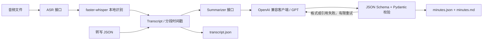

# MeetMind

按 [设计 v2](docs/design-v2.md) 实现的 M1：本地音频 → 带时间戳的转写 → 结构化会议纪要，导出 JSON 和 Markdown。

## 架构



`src/meetmind/asr/` 定义转写接口和本地实现；`summarize/` 定义纪要接口、提示词和客户端；
`models.py` 定义数据契约；`pipeline.py` 编排流程；`tools/export.py` 渲染；`cli.py` 提供命令行。
测试通过注入假 ASR 和假客户端隔离模型，离线 demo 使用明确标记的固定响应。

## 快速开始（PowerShell）

Python 3.10+。本机可使用指定解释器，无需 Git：

```powershell
& D:\python\python.exe -m venv .venv
& .\.venv\Scripts\python.exe -m pip install -e ".[dev,asr]"
# 也可以只安装 .[dev]，运行转写 JSON、离线 demo 和全部单元测试
& .\.venv\Scripts\meetmind.exe demo
Copy-Item .env.example .env
# 编辑 .env 填写 OPENAI_API_KEY，然后运行真实音频：
& .\.venv\Scripts\meetmind.exe run audio.wav --output-dir outputs/first-meeting
```

Linux/macOS：`python -m venv .venv`，随后使用 `.venv/bin/python` 和 `.venv/bin/meetmind`。
无需激活虚拟环境。不要重复创建已有虚拟环境；输出目录必须尚不存在。
省略 `--output-dir` 时会在 `outputs/` 中创建带随机后缀的新目录，避免覆盖。

首次本地 ASR 使用会下载模型权重，需要网络和磁盘空间；`ASR_MODEL` 可以设为已下载的本地模型目录。
默认 CPU / int8，语言自动识别；支持音频格式取决于 faster-whisper 的音频解码器。
无语音或无效录音会失败，不生成虚构转写。模型运行环境及 GPU 依赖参见
[faster-whisper 官方说明](https://github.com/SYSTRAN/faster-whisper#usage)。

## 配置与数据流

`.env` 默认从当前工作目录读取，或用 `--env-file path/to/.env` 指定；系统环境变量优先。
`.env.example` 是应纳入版本控制的配置模板，`.env` 已忽略。本目录未初始化 Git 仓库。

| 配置 | 默认值 / 用途 |
|---|---|
| `OPENAI_API_KEY` | 必填，仅真实 LLM 调用需要 |
| `OPENAI_BASE_URL` | `https://api.openai.com/v1`，可改兼容服务 |
| `OPENAI_MODEL` | `gpt-4o-mini`，可按服务支持情况修改 |
| `LLM_RESPONSE_FORMAT` | `json_schema`；兼容服务可显式改为 `json_object` 或 `text` |
| `LLM_TIMEOUT_SECONDS` | `60`，单次请求超时 |
| `LLM_MAX_ATTEMPTS` | `3`，结构化结果校验尝试上限 |
| `MAX_TRANSCRIPT_CHARS` | `60000`，发送的转写 JSON 字符数上限，超过则报错 |
| `ASR_MODEL` | `small`，模型名称或本地路径 |
| `ASR_DEVICE` / `ASR_COMPUTE_TYPE` | `cpu` / `int8` |
| `ASR_LANGUAGE` | 留空自动识别，或指定 `zh` / `en` 等 |

使用官方 Python SDK 的 Chat Completions 接口。默认向服务传递严格 JSON Schema，
并在本地再次校验字段类型及来源分段 ID；兼容模式也执行同样的本地校验。
参考 [OpenAI Structured Outputs](https://developers.openai.com/api/docs/guides/structured-outputs?api-mode=chat)。
服务不支持某种格式时会明确失败，不静默切换服务或模型。
SDK 对暂时性请求错误最多重试 2 次，结构化结果另按 `LLM_MAX_ATTEMPTS` 重试；
拒绝请求立即失败，截断、非法 JSON、字段或来源校验失败会重新请求完整结果。

音频由本地 ASR 处理，转写文本会发送到所配置的 LLM 服务；请使用有权处理的会议资料。
CLI 不打印密钥或原始 API 错误响应。结果包含会议文本，默认保存在已忽略的 `outputs/`。

## 输出和单独重试

每次成功运行生成：

- `transcript.json`：`language`、`segments`；每段有唯一 `id`、秒数 `start/end`、`text`、可空 `speaker`。
- `minutes.json`：`title`、`summary`、`topics`、`decisions`、`action_items`。
- `minutes.md`：人可读纪要、原文时间戳和跳转到分段的引用。

议题含 `title/discussion/source_segment_ids`；决策含 `text/source_segment_ids`；行动项含
`task/owner/due/source_segment_ids`。`owner`、`due` 未提及时必须为 `null`，无决策等使用空列表。
相对截止时间保留原话，不猜日期；本地 ASR 不进行说话人分离，`speaker` 为 `null`。
字段校验和有效引用不等于事实正确，真实纪要仍需人工核对。

在 LLM 调用前保存 `transcript.json`。若调用失败，保留转写以便重试：

```powershell
& .\.venv\Scripts\meetmind.exe summarize outputs/first-meeting/transcript.json --output-dir outputs/retry
# 对项目自带的原创虚构转写调用真实 LLM：
& .\.venv\Scripts\meetmind.exe summarize src/meetmind/samples/meeting.transcript.json
# 完全离线，不读取 .env，不下载 ASR 模型，不调用 LLM：
& .\.venv\Scripts\meetmind.exe demo --output-dir outputs/offline-demo
```

示例及对应固定纪要随包安装，许可与来源见 [samples/README.md](samples/README.md)。
Demo 的时间戳和纪要均为手工编写，不能作为音频识别或模型抽取质量的证据。
本次交付没有使用真实密钥调用 LLM，也没有下载权重执行真实语音识别。

## 开发与验证

```powershell
& .\.venv\Scripts\ruff.exe check .
& .\.venv\Scripts\ruff.exe format --check .
& .\.venv\Scripts\python.exe -m pytest -q
```

测试不需要网络、密钥或 ASR 权重：覆盖假音频到导出的完整链路、CLI、SDK 请求契约、
ASR 适配器、校验失败重试、未知负责人、配置优先级与错误处理。
GitHub Actions 在 Python 3.10、3.12、3.14 上运行 lint、格式检查、离线测试与 demo；
工作流已写好，尚未在 GitHub 远端执行。

本次本地验证（Windows，`D:\python\python.exe`，Python 3.14.7）：
`ruff check .`、`ruff format --check .` 均通过，`pytest -q` 为 **37 passed**；
`pip check` 无依赖冲突，faster-whisper 导入成功，CLI 离线 demo 已生成三个输出文件。
这些结果仅验证软件行为，不是 ASR 或纪要质量评测。

## 路线图与限制

| 里程碑 | 状态与范围 |
|---|---|
| M1 | 已实现 CLI、ASR 接口及 faster-whisper、GPT 兼容调用、结构化校验与重试、JSON/Markdown、离线示例、测试及 CI 配置 |
| M2 | 待实现 Agent 工具调用、待办和日历工具、历史会议混合检索 RAG、FastAPI 与 Web 界面 |
| M3 | 待建设有授权的评测集、CER/行动项 F1/召回率等真实评测、bad case、MCP Server、Docker 和演示材料 |

README 和 CI 按本次要求提前到 M1。说话人分离、实时音频、长会议分块、任务外部写入、
DOCX 导出均未实现。没有声称任何模型准确率、性能或质量指标，单元测试通过不代表模型效果。

MIT License。
